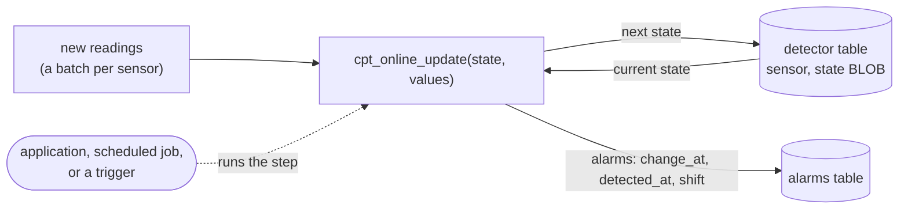
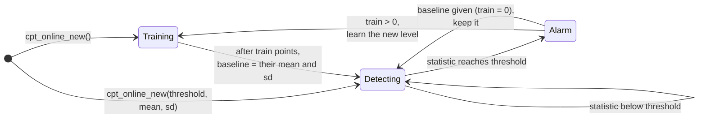

# DuckDB Changepoint Extension (`cpt`)

Offline change point detection inside DuckDB: PELT, binary segmentation, exact dynamic programming
and CROPS penalty sweeps over four segment costs (mean, mean + variance, Poisson rate, median).
For DuckDB 2.0: a C++ extension, built with DuckDB, whose numerical core and SQL functions are C11. For
DuckDB 1.5.x, use the [`v1.5.x`](https://github.com/hugr-lab/duck-changepoint/tree/v1.5.x) branch,
which keeps the build on the stable C extension API.

```sql
LOAD cpt;

SELECT cpt_pelt(list(value ORDER BY ts), 'l2') AS bkps FROM readings;
-- [250, 500, 750, 1000]
```

## Contents

- [Installation](#installation)
- [Functions](#functions)
- [Online detection](#online-detection)
- [Examples](#examples)
- [Costs](#costs)
- [Penalties](#penalties)
- [Differences from ruptures and changepoint](#differences-from-ruptures-and-changepoint)
- [Performance](#performance)
- [Limits and cancellation](#limits-and-cancellation)
- [Building and testing](#building-and-testing)
- [License](#license)
- [Talks](#talks)
- [References](#references)

Further documentation: [docs/online.md](docs/online.md), [docs/examples-from-talks.md](docs/examples-from-talks.md), [docs/architecture.md](docs/architecture.md), [docs/algorithms.md](docs/algorithms.md),
[docs/costs-and-penalties.md](docs/costs-and-penalties.md), [docs/TESTING.md](docs/TESTING.md),
[DEVELOPMENT.md](DEVELOPMENT.md). The same documentation as a site:
https://hugr-lab.github.io/duck-changepoint/.

## Installation

From the DuckDB community extensions, on DuckDB 2.0:

```sql
INSTALL cpt FROM community;
LOAD cpt;
```

To run the current source, build it (see [Building and testing](#building-and-testing)) and load the
unsigned binary into DuckDB 2.0.0:

```sh
duckdb -unsigned -c "LOAD 'build/release/extension/cpt/cpt.duckdb_extension'; SELECT cpt_pelt([0,0,0,9,9,9]::DOUBLE[], 'l2', 1.0);"
```

From Python: `duckdb.connect(config={"allow_unsigned_extensions": "true"})`, then `LOAD '<path>'`.

A C++ extension loads only into the DuckDB release it was built for. For DuckDB 1.5.6 to 1.5.x, build
the [`v1.5.x`](https://github.com/hugr-lab/duck-changepoint/tree/v1.5.x) branch: its binary is on the
stable C API and loads in every release from 1.5.6 on.

## Functions

Every function takes one ordered series per row as `DOUBLE[]` (build it with
`list(x ORDER BY ts)`; `INTEGER[]` and `BIGINT[]` cast implicitly). The results are the **1-based
end positions of the segments**, in increasing order, with the last element equal to `n`:
`[250, 500, 1000]` means rows 1–250, 251–500 and 501–1000.

- A `NULL` series returns `NULL`.
- An empty list returns `[]`.
- A `NULL`, `NaN` or `±inf` element raises an error.

The C API has no `DEFAULT` parameters, so each function is registered as a set of overloads, one per
number of trailing arguments. Passing `NULL` for an optional argument means "use the default".

| Function | Overloads | Returns |
|---|---|---|
| `cpt_pelt` | `(series)`<br>`(series, cost)`<br>`(series, cost, penalty DOUBLE)`<br>`(series, cost, penalty DOUBLE, min_size)`<br>`(series, cost, penalty_name VARCHAR)`<br>`(series, cost, penalty_name VARCHAR, min_size)` | `INTEGER[]` |
| `cpt_binseg` | `(series)`<br>`(series, cost)`<br>`(series, cost, n_bkps)`<br>`(series, cost, n_bkps, penalty)`<br>`(series, cost, n_bkps, penalty, min_size)` | `INTEGER[]` |
| `cpt_dynp` | `(series, n_bkps)`<br>`(series, n_bkps, cost)`<br>`(series, n_bkps, cost, min_size)` | `INTEGER[]` |
| `cpt_crops` | `(series, cost, pen_min, pen_max)`<br>`(series, cost, pen_min, pen_max, min_size)` | `STRUCT(penalty DOUBLE, n_bkps INTEGER, bkps INTEGER[])[]` |
| `cpt_segment_stats` | `(series, bkps)` | `STRUCT(start INTEGER, "end" INTEGER, mean DOUBLE, var DOUBLE, n INTEGER)[]` |

Argument types: `series DOUBLE[]`, `cost VARCHAR`, `penalty`/`pen_min`/`pen_max DOUBLE`,
`n_bkps`/`min_size BIGINT` (integer literals bind directly), `bkps BIGINT[]` (the `INTEGER[]`
returned by the other functions widens implicitly).

Defaults: `cost = 'l2'`, `penalty = NULL` (BIC), `min_size = 1`.

**`cpt_pelt`**: the exact minimiser of *Σ segment cost + β · (number of change points)*, found with
PELT (Killick, Fearnhead & Eckley 2012). `penalty` is a number β ≥ 0, or one of `'bic'`, `'mbic'` or
`'aic'` (case-insensitive). `NULL` means BIC.

**`cpt_binseg`**: greedy binary segmentation. Pass `n_bkps` to stop after that many splits, or
`penalty` to stop once the best split gains no more than the penalty. Passing both is an error.
Passing neither uses BIC. If the greedy search runs out of admissible splits, it returns fewer than
`n_bkps` change points.

**`cpt_dynp`**: the optimal split into exactly `n_bkps + 1` segments (segment neighbourhood, as in
ruptures' `Dynp` and changepoint's `SegNeigh`). It is exact and takes O(n_bkps · n²) time.

**`cpt_crops`**: every distinct segmentation that PELT produces for penalties in `[pen_min, pen_max]`
(Haynes, Eckley & Fearnhead 2017). The result is ordered by `penalty` ascending, which is `n_bkps`
descending. `penalty` is the smallest penalty in the sweep at which PELT returned that segmentation,
so `cpt_pelt(series, cost, penalty)` reproduces `bkps`.

**`cpt_segment_stats`**: per-segment start, end (1-based, inclusive), mean, sample variance (`NULL`
for a one-element segment) and length. `bkps` must be strictly increasing and end at `n`.

`min_size` is the minimum number of points in a segment. The `normal` cost always uses at least 2.

## Online detection

The functions above are *offline*: they look at a whole series and find every change point in it.
The `cpt_online_*` functions watch a *stream* instead. They take new points as they arrive and raise
an alarm as soon as the mean has changed, typically a few dozen points after the change.

The detector is a value. Its state is a small `BLOB` (a few hundred bytes) that `cpt_online_update`
takes together with a batch of new points, returning the next state and any alarms. Keep the state
in a table and advance it whenever data arrives:



```sql
CREATE TABLE detector AS SELECT 'sensor-1' AS sensor, cpt_online_new() AS state;
CREATE TABLE alarms (sensor VARCHAR, change_at BIGINT, detected_at BIGINT, shift DOUBLE, statistic DOUBLE);

-- for each batch of new readings
CREATE OR REPLACE TEMP TABLE step AS
SELECT d.sensor, cpt_online_update(d.state, b.xs) AS r
FROM detector d JOIN (SELECT sensor, list(value ORDER BY ts) AS xs FROM new_readings GROUP BY sensor) b USING (sensor);

INSERT INTO alarms SELECT sensor, unnest(r.alarms, recursive := true) FROM step;
UPDATE detector SET state = step.r.state FROM step WHERE detector.sensor = step.sensor;

-- backtest a detector over history, e.g. to choose the threshold
SELECT cpt_online(list(value ORDER BY ts)) FROM readings;
```

How the batches are split does not matter. Feeding the points in any batches, down to one point at a
time, gives exactly the same alarms as `cpt_online` over the whole series. Advancing a stored state
takes about 0.5 ms per `UPDATE`. DuckDB 2.0 triggers can drive the step once they mature, but they are
not required: anything that runs the `UPDATE` works.

Inside, the detector first learns a baseline (mean and standard deviation) from its first `train`
points. It then computes, after every point, how strongly the data since some earlier point departs
from that baseline. That is the statistic, and when it reaches the threshold, an alarm is raised:



| Function | Returns |
|---|---|
| `cpt_online_new([threshold [, train \| , mean, sd]])` | `BLOB`: a new detector. Defaults: threshold 15, baseline from 100 points |
| `cpt_online_update(state, values DOUBLE[])` | `STRUCT(state BLOB, n BIGINT, statistic DOUBLE, training BOOLEAN, alarms ALARM[])` |
| `cpt_online(series [, threshold [, train \| , mean, sd]])` | `ALARM[]`: a fresh detector run over a whole series |

`ALARM` is `STRUCT(change_at BIGINT, detected_at BIGINT, shift DOUBLE, statistic DOUBLE)`:
- `change_at`: the estimated last point before the change, as in the offline segment ends.
- `detected_at`: the point that raised the alarm.
- `shift`: the estimated change in mean, in the data's units.

Positions count from 1 since the detector was created.

**The statistic.** With the points standardised by the baseline and S_k their running sum, the
statistic after k points is max over earlier points τ of (S_k − S_τ)² / (2 (k − τ)). This is the
likelihood ratio of "the mean changed after τ" for the best τ and the best change size, in either
direction. It is FOCuS⁰ (Romano, Eckley, Fearnhead & Rigaill 2023, from Fearnhead's talk below):
Page's CUSUM for every change size at once. It is exact, and on noise only about log n candidate
change points need to be kept (fewer than 60 over 200,000 points), so a backtest over 1 million
points takes about 40 ms.

**Choosing the threshold** trades false alarms against delay. At the default of 15, noise gives
roughly one false alarm per 10⁵–10⁶ points, and a shift of one standard deviation is found after about
30 points. A baseline learned from few points raises more false alarms than a known one. See
[docs/online.md](docs/online.md) for the full table, the limits of the model and the state format.

## Examples

Basic use on a time series table:

```sql
SELECT cpt_pelt(list(value ORDER BY ts), 'l2') AS bkps
FROM readings;
```

Per group, with the default BIC penalty and a minimum segment length of 5:

```sql
SELECT sensor_id,
       cpt_pelt(list(value ORDER BY ts), 'normal', NULL, 5) AS bkps
FROM readings
GROUP BY sensor_id;
```

Labelling every row with its segment number:

```sql
WITH s AS (
  SELECT sensor_id,
         list(value ORDER BY ts) AS xs,
         list(ts ORDER BY ts)    AS tss
  FROM readings GROUP BY sensor_id
), b AS (
  SELECT sensor_id, xs, tss, cpt_pelt(xs, 'l2') AS bkps FROM s
)
SELECT sensor_id,
       unnest(tss) AS ts,
       unnest(xs)  AS value,
       -- segment number = 1 + number of segment ends strictly before this position
       unnest(list_transform(range(1, len(xs) + 1),
              lambda pos: len(list_filter(bkps, lambda e: e < pos)) + 1)) AS segment
FROM b;
```

DuckDB 2.0 rejects the old `x -> ...` lambda syntax by default. Use `lambda x: ...`, which works in 1.5
and 2.0. For long series, joining row positions (`generate_subscripts(xs, 1)`) to
`cpt_segment_stats` ranges avoids the O(n · k) lambda; `test/sql/cpt_segment_stats.test` shows both
forms.

Segment statistics:

```sql
SELECT sensor_id, unnest(cpt_segment_stats(xs, cpt_pelt(xs, 'l2')))
FROM s;
```

Penalty sweep with CROPS:

```sql
SELECT unnest(cpt_crops(xs, 'l2', 2 * ln(len(xs)), 50 * ln(len(xs))))
FROM s;
```

Known number of change points:

```sql
SELECT cpt_dynp(xs, 3, 'l2') FROM s;
```

Generating test series in SQL (mirrors `ruptures.pw_constant`): 4 segments of 250, noise σ = 1,
with Box-Muller normals:

```sql
SELECT setseed(0.42);
SELECT cpt_pelt(list(
         CASE WHEN i < 250 THEN 0 WHEN i < 500 THEN 5 WHEN i < 750 THEN -3 ELSE 2 END
         + sqrt(-2 * ln(random())) * cos(2 * pi() * random())
         ORDER BY i), 'l2')
FROM range(1000) t(i);
-- [250, 500, 750, 1000]
```

In a dbt project: [dbt-duckdb-trading-calendar](https://github.com/oluies/dbt-duckdb-trading-calendar#change-point-example-with_changepoint)
finds volatility regimes in the Riksbank's daily SEK/EUR fixing, indexed on Nasdaq Stockholm trading
days. Its model collects the daily log returns into a list, runs PELT with the `normal` cost and MBIC,
and maps segment positions back to dates:

```sql
SELECT days[seg.start] AS start_date, days[seg."end"] AS end_date,
       seg.n AS trading_days, sqrt(seg.var * 252) AS annualised_vol_pct
FROM (SELECT days, unnest(cpt_segment_stats(xs, cpt_pelt(xs, 'normal', 'mbic', 20))) AS seg
      FROM series);
```

It finds the COVID sell-off in spring 2020 and the April 2025 tariff shock. The
[interactive chart](https://oluies.github.io/dbt-duckdb-trading-calendar/) explains each query and
parameter.

## Costs

C(a, b) is the cost of the segment of points a+1..b, with length *n* = b − a and segment sum *S*.
Every cost is evaluated in O(1) after an O(n) pass of prefix sums, except `l1`.

| `cost` | C(a, b) | Models | p | Evaluation |
|---|---|---|---|---|
| `'l2'` | Σ (xᵢ − x̄)² | change in mean, known variance | 1 | O(1) |
| `'normal'` | n · ln σ̂², σ̂² = Σ (xᵢ − x̄)² / n | change in mean and variance | 2 | O(1) |
| `'poisson'` | −2 (S ln(S/n) − S), 0 when S = 0 | change in rate of counts | 1 | O(1) |
| `'l1'` | Σ \|xᵢ − median\| | change in median (robust) | 1 | O(log n) |

- `normal` floors σ̂² at 1e-11, the same as changepoint, so runs of equal values do not get cost −∞.
  The floor is absolute, so rescale series whose variance is below about 1e-9. Segments have at
  least 2 points.
- `poisson` requires non-negative integer values and raises an error otherwise.
- `l1` answers median and partial-sum queries with a wavelet matrix: O(n log n) to build,
  O(log n) per segment, and about 12 · n · log₂ n bytes of memory (≈ 240 MB at n = 1e6).

All four satisfy C(a, s) + C(s, b) ≤ C(a, b), so PELT prunes with K = 0 (Killick et al. 2012,
Theorem 3.1). See [docs/costs-and-penalties.md](docs/costs-and-penalties.md) for the derivations.

## Penalties

The penalty is charged per change point, with p parameters per segment as listed in the table above:

| name | β | extra |
|---|---|---|
| `'bic'` (default) | (p + 1) · ln n | |
| `'mbic'` | (p + 2) · ln n | + Σ ln(nᵢ) over segments (Zhang & Siegmund 2007) |
| `'aic'` | 2 (p + 1) | |

These are the values used by R's changepoint, where the change location counts as one more
parameter. For `l2`, BIC is 2 ln n.

BIC assumes the cost is a −2 log-likelihood. For `l2` that means unit noise variance: divide the
series by its noise standard deviation (as changepoint's `cpt.mean` expects), or pass an explicit
penalty such as `2 * σ² * ln(n)`. `l1` has no likelihood scale, so treat its BIC as a starting point
and use `cpt_crops` to see the alternatives.

## Differences from ruptures and changepoint

| | cpt | ruptures | changepoint (R) |
|---|---|---|---|
| Output | segment ends, 1-based, incl. n: `[28, 100]` | 0-based exclusive ends incl. n: same numbers | `cpts()`: last index of each segment except the final one: `28` |
| Penalty unit | per change point | per segment (same optimum) | per change point |
| Default penalty | BIC | none (`pen` is required) | MBIC |
| PELT `min_size` / `minseglen` default | 1 (2 for `normal`) | `min_size=2`, `jump=5` | 1 for mean, 2 for meanvar |
| PELT pruning with `min_size > 1` | exact (below) | heuristic | heuristic |
| `normal` cost constant | n ln σ̂² | n ln σ̂² (+ small diagonal) | n (ln 2π + ln σ̂² + 1): same optimum |
| `l1` cost | yes | `CostL1` | no |
| Binseg stop | `n_bkps`, or gain > penalty | same | same |

**Exact pruning with a minimum segment length.** PELT drops a candidate s at time t when
F(s) + C(s, t) + K > F(t). The proof that s can never become optimal again uses t as the last change
before a later t′, and with a minimum segment length m that option only exists for t′ ≥ t + m. ruptures
and changepoint drop s immediately and can lose the optimum when m > 1. cpt keeps such candidates
until t + m. On the `wave.c44137` and `ftse100` reference series, changepoint's
`cpt.meanvar(method = "PELT")` returns segmentations with a higher penalised cost than unpruned
Optimal Partitioning finds, while cpt matches it. The companion repository
[duck-changepoint-reference](#reference-data-against-r-changepoint) checks this.

**Matching ruptures.** Use `Pelt(model="l2", min_size=m, jump=1).fit(x).predict(pen=β)` against
`cpt_pelt(x, 'l2', β, m)`. `test/python/compare_ruptures.py` does this over random series (PELT `l2`
and `l1`, Binseg, Dynp), and all results agree. The only exceptions are a few `l1` ties, where both
answers have the same cost to the last digit.

**Matching changepoint.** `cpt.mean(x, method = "PELT", penalty = "BIC")` corresponds to
`cpt_pelt(x, 'l2', 'bic')` (scale x to unit variance first), and `cpt.meanvar` corresponds to
`'normal'`. On Nile and Lai2005fig4 the results are identical (see
[Reference data against R changepoint](#reference-data-against-r-changepoint)).

## Performance

`make bench` (Apple M-series laptop, DuckDB 2.0.0, l2 PELT, segments of 600 points):

| n | time | segments |
|---|---|---|
| 1e4 | 0.01 s | 16 |
| 1e5 | 0.08 s | 152 |
| 1e6 | 0.84 s | 1516 |

PELT runs in linear expected time when the number of change points grows with n. With only a few
change points in a very long series, little can be pruned inside the long segments and the run time
approaches O(n²). Binary segmentation stays O(n log n) in that case: on 1e5 points with 3 changes it
takes 2 ms, against 0.1 s for l2 PELT and about 6 s for l1 PELT, where each evaluation costs
O(log n). `cpt_dynp` is O(n_bkps · n²) and meant for series up to roughly 1e4 points.

## Limits and cancellation

A running `cpt_*` call stops when its query is interrupted (Ctrl-C in the CLI, `con.interrupt()` in
Python): the algorithms check once per outer step, so a call stops within one step, and every later
series in the same vector stops at its first step. A query over 32 series of 40,000 points with one
change each (l2 PELT, no work limit), which runs for 46 s on an Apple M-series laptop, stops 0.02 s
after an interrupt; so does `l1` PELT on one series of 200,000 points. (On the stable C API build of the `v1.5.x` branch a running call cannot be
interrupted; see [#2](https://github.com/hugr-lab/duck-changepoint/issues/2).)

Every call (one series) also has a work limit:

```sql
SET cpt_max_evaluations = 1000000000;   -- default; 0 = no limit
```

The unit is one segment cost evaluation. An `l1` evaluation counts log₂ n units and a `normal`
evaluation counts 2, so the limit means roughly the same time for every cost. At the default, a call
stops after about 2–3 s on a laptop with an error that says why. PELT on 200,000 points with a single
change would otherwise take about 25 s (l2) or several minutes (l1). The 1e6-point benchmark above uses
about 3.8 × 10⁸ units. The limit applies to PELT, Binseg, Dynp and to a whole CROPS sweep, and it is per
series. Series in the same vector (up to 2,048 rows) run one after another on a single thread.

When the limit is hit, the error message suggests what to do. For long series with few changes,
`cpt_binseg` (O(n log n)) finds the same change in milliseconds. To raise or remove the limit,
`SET cpt_max_evaluations`. On a server where users send their own SQL, set it globally
(`SET GLOBAL cpt_max_evaluations = ...`) and, if needed, stop users from changing it with DuckDB's
`SET lock_configuration = true`.

## Building and testing

Requirements: CMake ≥ 3.5, a C11 and C++17 compiler, Python 3, git, and ninja (optional, `GEN=ninja`)
and uv for the Python checks.

```sh
git clone --recurse-submodules <repo> && cd duck-changepoint
GEN=ninja make release   # builds DuckDB v2.0.0 from the submodule, then build/release/extension/cpt/cpt.duckdb_extension
```

These checks gate CI:

```sh
make test_release     # SQL logic tests in DuckDB's unittest
make test_core        # C tests of the numerical core under ASan/UBSan
make test_threads     # the core on 8 threads under ThreadSanitizer
make leak_check       # every function under macOS `leaks`, against this tree's debug build
make crap             # CRAP < 10 for every C and C++ function (lizard + llvm-cov)
```

These are run by hand:

```sh
make compare_ruptures   # 200 random series against ruptures
make check_optimality   # PELT against unpruned Optimal Partitioning
make bench              # timings above
make joern_leaks        # static allocation/release audit with Joern
```

See [DEVELOPMENT.md](DEVELOPMENT.md) and [docs/TESTING.md](docs/TESTING.md).

### Reference data against R changepoint

The comparison with R's changepoint package on Nile, Lai2005fig4, wave.c44137 and ftse100 lives in a
separate repository, [hugr-lab/duck-changepoint-reference](https://github.com/hugr-lab/duck-changepoint-reference), because three of those datasets are distributed with
changepoint under the GPL. With both repositories checked out side by side:

```sh
cd ../duck-changepoint-reference
make test                         # against the extension built in ../duck-changepoint
make reference-data               # regenerate the data with R changepoint in a container
```

## License

MIT, see [LICENSE](LICENSE). DuckDB, built with the extension from the `duckdb` submodule and linked into
the loadable binary, is MIT-licensed by the DuckDB Foundation ([LICENSES/](LICENSES/README.md)). This repository contains no GPL code or data:
the algorithms are implemented from the published papers, and the changepoint-derived reference data is
kept in `duck-changepoint-reference` (GPL-2.0-or-later).

## Talks

The examples from both talks are rebuilt in SQL in [docs/examples-from-talks.md](docs/examples-from-talks.md).

- **Paul Fearnhead, "Fast Online Changepoint Detection via Functional Pruning CUSUM Statistics"**
  ([recording](https://media.ed.ac.uk/media/Fast+Online+Changepoint+Detection+via+Functional+Pruning+CUSUM+Statistics+-+Paul+Fearnhead/1_w941egwk),
  University of Edinburgh Media Hopper, ICMS workshop "Structural Breaks and Shape Constraints",
  May 2022).
  One of PELT's authors on functional pruning, the idea behind FPOP and the online detector FOCuS
  ([JMLR 2023](https://www.jmlr.org/beta/papers/v24/21-1230.html)). cpt implements PELT's
  inequality-based pruning, not functional pruning; the talk shows where the field went next.
- **Matt Fleming, "Using Change Point Detection to Fight Noisy Benchmark Results"**
  ([session page](https://www.p99conf.io/session/using-change-point-detection-to-fight-noisy-benchmark-results/),
  P99 CONF, 16 min, free registration required to watch;
  [slides](https://www.slideshare.net/slideshow/using-change-point-detection-to-fight-noisy-benchmark-results-by-matt-fleming/272474341)).
  Change point detection on noisy performance data in practice, with the open-source tools Hunter
  and Nyrkiö ([Hunter paper](https://arxiv.org/abs/2301.03034)).

## References

- Killick, R., Fearnhead, P., Eckley, I. A. (2012). Optimal detection of changepoints with a linear
  computational cost. *JASA* 107(500), 1590–1598.
- Truong, C., Oudre, L., Vayatis, N. (2020). Selective review of offline change point detection
  methods. *Signal Processing* 167, 107299.
- Haynes, K., Eckley, I. A., Fearnhead, P. (2017). Computationally efficient changepoint detection
  for a range of penalties. *JCGS* 26(1), 134–143.
- Zhang, N. R., Siegmund, D. O. (2007). A modified Bayes information criterion with applications to
  the analysis of comparative genomic hybridization data. *Biometrics* 63(1), 22–32.
- Jackson, B. et al. (2005). An algorithm for optimal partitioning of data on an interval.
  *IEEE Signal Processing Letters* 12(2), 105–108.
