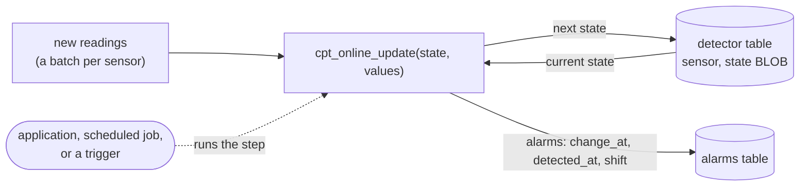
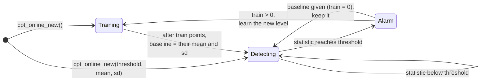

<!-- Generated by website/sync_pages.py from the repository's Markdown: edit the source, not this file. -->

The functions above are *offline*: they look at a whole series and find every change point in it.
The `cpt_online_*` functions watch a *stream* instead. They take new points as they arrive and raise
an alarm as soon as the mean has changed, typically a few dozen points after the change.

The detector is a value. Its state is a small `BLOB` (a few hundred bytes) that `cpt_online_update`
takes together with a batch of new points, returning the next state and any alarms. Keep the state
in a table and advance it whenever data arrives:



```sql
CREATE TABLE detector AS SELECT 'sensor-1' AS sensor, cpt_online_new() AS state;
CREATE TABLE alarms (sensor VARCHAR, change_at BIGINT, detected_at BIGINT, shift DOUBLE, statistic DOUBLE);

-- for each batch of new readings
CREATE OR REPLACE TEMP TABLE step AS
SELECT d.sensor, cpt_online_update(d.state, b.xs) AS r
FROM detector d JOIN (SELECT sensor, list(value ORDER BY ts) AS xs FROM new_readings GROUP BY sensor) b USING (sensor);

INSERT INTO alarms SELECT sensor, unnest(r.alarms, recursive := true) FROM step;
UPDATE detector SET state = step.r.state FROM step WHERE detector.sensor = step.sensor;

-- backtest a detector over history, e.g. to choose the threshold
SELECT cpt_online(list(value ORDER BY ts)) FROM readings;
```

How the batches are split does not matter. Feeding the points in any batches, down to one point at a
time, gives exactly the same alarms as `cpt_online` over the whole series. Advancing a stored state
takes about 0.5 ms per `UPDATE`. DuckDB 2.0 triggers can drive the step once they mature, but they are
not required: anything that runs the `UPDATE` works.

Inside, the detector first learns a baseline (mean and standard deviation) from its first `train`
points. It then computes, after every point, how strongly the data since some earlier point departs
from that baseline. That is the statistic, and when it reaches the threshold, an alarm is raised:



| Function | Returns |
|---|---|
| `cpt_online_new([threshold [, train \| , mean, sd]])` | `BLOB`: a new detector. Defaults: threshold 15, baseline from 100 points |
| `cpt_online_update(state, values DOUBLE[])` | `STRUCT(state BLOB, n BIGINT, statistic DOUBLE, training BOOLEAN, alarms ALARM[])` |
| `cpt_online(series [, threshold [, train \| , mean, sd]])` | `ALARM[]`: a fresh detector run over a whole series |

`ALARM` is `STRUCT(change_at BIGINT, detected_at BIGINT, shift DOUBLE, statistic DOUBLE)`:
- `change_at`: the estimated last point before the change, as in the offline segment ends.
- `detected_at`: the point that raised the alarm.
- `shift`: the estimated change in mean, in the data's units.

Positions count from 1 since the detector was created.

**The statistic.** With the points standardised by the baseline and S_k their running sum, the
statistic after k points is max over earlier points τ of (S_k − S_τ)² / (2 (k − τ)). This is the
likelihood ratio of "the mean changed after τ" for the best τ and the best change size, in either
direction. It is FOCuS⁰ (Romano, Eckley, Fearnhead & Rigaill 2023, from Fearnhead's talk below):
Page's CUSUM for every change size at once. It is exact, and on noise only about log n candidate
change points need to be kept (fewer than 60 over 200,000 points), so a backtest over 1 million
points takes about 40 ms.

**Choosing the threshold** trades false alarms against delay. At the default of 15, noise gives
roughly one false alarm per 10⁵–10⁶ points, and a shift of one standard deviation is found after about
30 points. A baseline learned from few points raises more false alarms than a known one. See
[docs/online.md](/online-details/) for the full table, the limits of the model and the state format.
